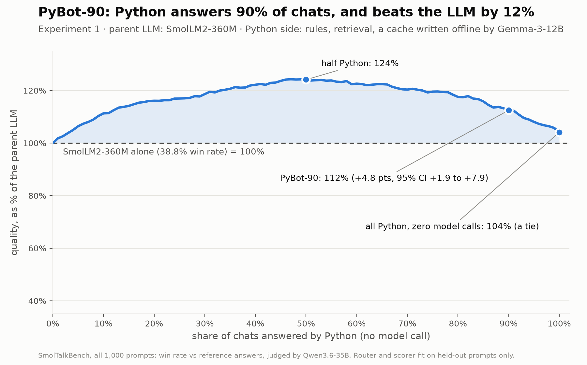
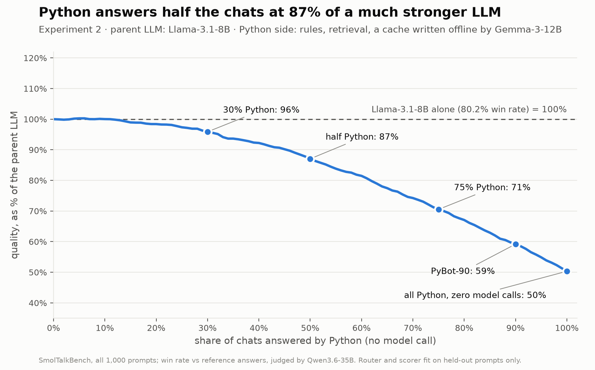

# PyBot-90: a Python chatbot that only calls the AI one time in ten

Every chat sent to a language model costs money and time. Many of those chats are easy, like "how do I boil an egg?" or "what's a good name for a cat?". A big model isn't needed to answer them well.

So we tried something simple: **let plain Python answer as many chats as it can, and only call the AI when Python is likely to do worse.**

Our target was **PyBot-90**. Python answers 90% of chats, the AI answers the other 10%, and the result should be as good as the AI answering everything.

## How it works

There are three pieces.

**1. A big answer book.** Ahead of time, we wrote about 33,000 everyday questions and had a stronger model answer each one once. That's a one-off cost, done offline. After that the answers are just text in a file.

**2. Python looks things up.** When a chat comes in, Python finds the most similar question in the answer book and offers that answer. It also has a few other Python-made candidate replies to pick from.

**3. A small referee decides.** A tiny scoring model looks at the chat and the Python candidates. Then it asks: *is the best Python answer probably good enough, or should we call the AI?* Only the hard cases go to the AI.

No neural network runs when Python answers. It's a lookup and a quick score.

## How we measured it

We used 1,000 real-style chat prompts. A large AI judge compared each reply against a reference answer and said which was better. That gives a "win rate": higher is better.

## What happened

**Against a small model (SmolLM2-360M):**

| Setup | AI calls | Win rate |
|---|---:|---:|
| The AI answers everything | 100% | 38.8% |
| Python only | 0% | 40.4% |
| **PyBot-90** | **10%** | **43.6%** |
| Half and half | 50% | 48.1% |

PyBot-90 works here. With only one AI call in ten, the hybrid **beats** the AI on its own by about 5 points, and that gap holds up statistically.

**Against a stronger model (Llama-3.1-8B):**

| Setup | AI calls | Win rate | Share of the AI's quality |
|---|---:|---:|---:|
| The AI answers everything | 100% | 80.2% | 100% |
| PyBot-90 | 10% | 47.5% | 59% |
| Half and half | 50% | 69.8% | 87% |

Against a strong model, Python can't keep up on its own. But sending only half the chats to the AI still keeps 87% of its quality.

## Wait, how can the hybrid beat the AI?

This surprised us too. The small AI isn't great: on some questions its answer is worse than the pre-written one in the answer book. The referee gets to pick the better of the two, so the mix beats either one alone.

With a strong AI that rarely loses to the answer book, this effect mostly disappears, which is why the second chart looks the way you'd expect.

## The honest caveat

The answer book was written by a bigger model (Gemma-3-12B), once, offline. So a fair way to say it is:

> A lookup table distilled from a 12B model, plus a 360M model on 10% of chats, beats the 360M model on every chat.

That's still a useful trade. Writing the book is a one-time cost, and every chat after that is almost free.

## What we learned

- **The answer book matters most.** Swapping who wrote it took Python alone from 31% to 40%. Better answers in the book lift everything.
- **But better writers stop helping.** Going from an 8B to a 12B writer only added a few points.
- **The real limit is "similar, not same".** A looked-up answer replies to a *nearby* question, not the one the user actually asked. Closing that gap, for example by adapting the cached answer to the real question, is the next step toward matching strong models.

## The takeaway

You don't need to call an AI for every message. A good answer book, a lookup, and a small referee can handle most chats, and when the AI is small they can even beat it.
